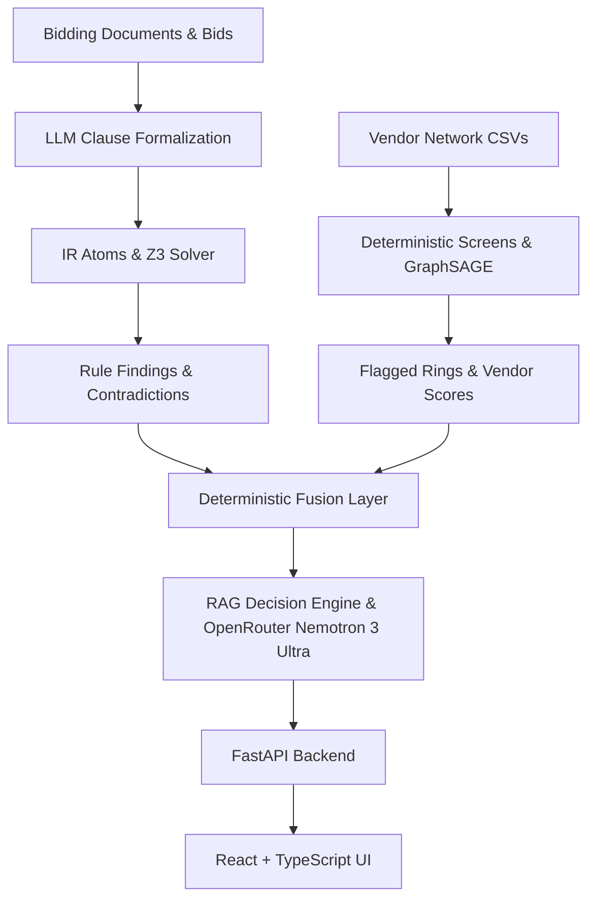
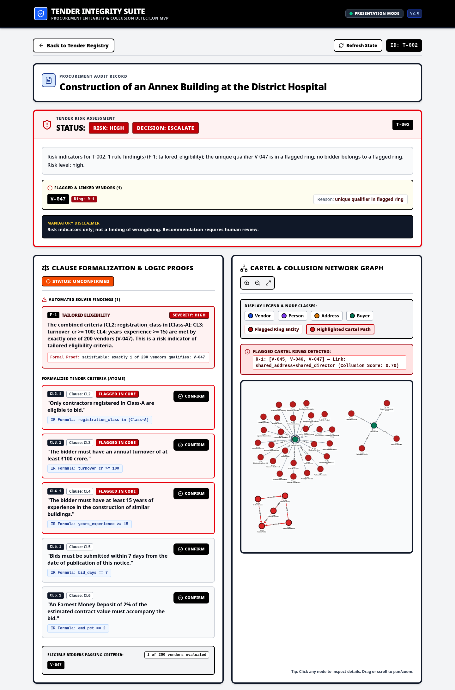
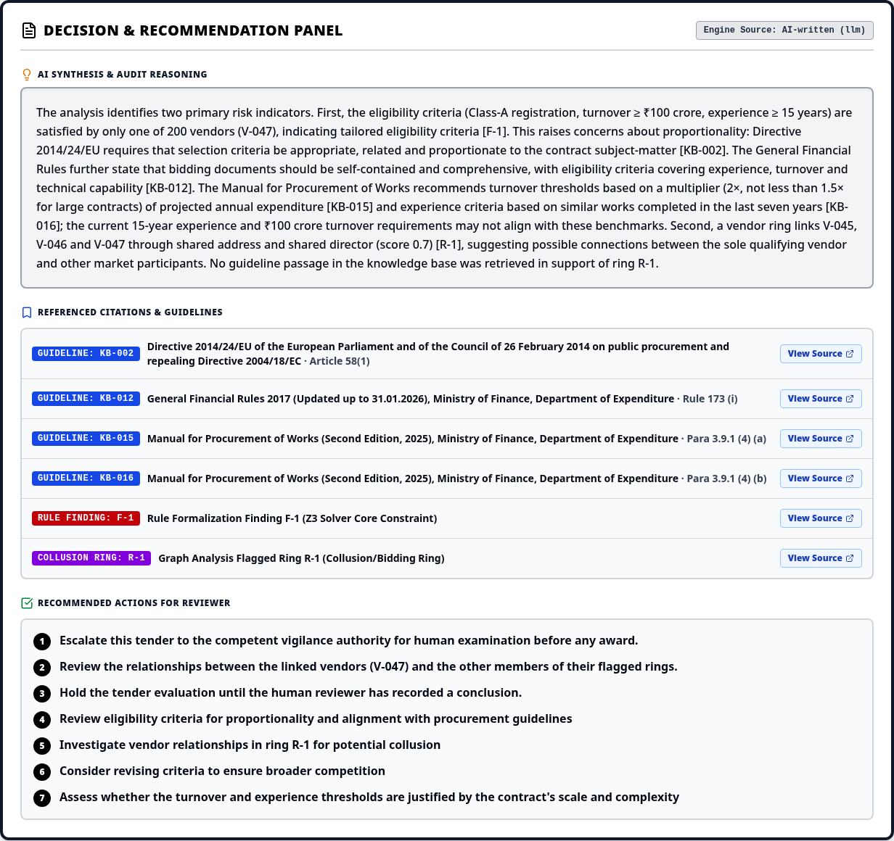

# TenderFender

TenderFender is an automated tender integrity and risk-screening platform designed to analyze public procurement documents, detect contradiction and tailored eligibility risks using formal methods (Z3) and LLMs, screen vendor networks for collusive bidding rings (using deterministic baseline screens and GraphSAGE), fuse findings, and generate evidence-backed RAG decisions for human review.

## 1. Overview & Live Demo

- **Pitch:** Public tenders can be drafted with contradictory criteria or tailored so that only one preferred supplier qualifies. TenderFender automates the detection of these risk indicators, matching them against authoritative procurement guidelines to provide cited recommendations for human reviewers.
- **Live Demo URL:** [https://cl5srhq2lbhpd775etjbpso6sy0fwrtt.lambda-url.ap-south-1.on.aws/](https://cl5srhq2lbhpd775etjbpso6sy0fwrtt.lambda-url.ap-south-1.on.aws/)
- **Disclaimer:** All risk indicators, scores, and recommendations are strictly for human review and do not constitute legal findings of wrongdoing, guilt, or corruption.

---

## 2. Architecture & Workflow

### Data Flow & Processing Pipeline



### Deterministic Risk and Decision Rules
- **T-001 (Review):** Triggered when formalized clauses directly contradict (e.g., conflicting annual turnover thresholds such as $\ge ₹50$ crore vs $\le ₹10$ crore proven via Z3 unsat cores). Risk level: **medium**, recommendation: **review**.
- **T-002 (Escalate):** Triggered by tailored eligibility (e.g., criteria qualifying exactly 1 vendor out of 200) where that qualifying vendor participates in a flagged collusive bidding ring ($score \ge 0.5$). Risk level: **high**, recommendation: **escalate**.
- **T-003 (Clear):** Clean control with consistent criteria, multiple qualifying bidders, and zero findings or ring memberships. Risk level: **low**, recommendation: **clear**.

---

## 3. Demo Scenarios Table

| Scenario ID | Tender Title / Focus | Expected Risk & Decision | Actual Pipeline Result | Status |
|---|---|---|---|---|
| **T-001** | Supply, Installation and Commissioning of Water Treatment Equipment at the Municipal Water Works | Medium / Review | Contradiction between CL2 and CL5; Z3 unsat core found; source `cache` (saved AI-written decision, generated by `llm`). | Verified |
| **T-002** | Construction of an Annex Building at the District Hospital | High / Escalate | Tailored eligibility (`qualifying_vendors == ["V-047"]`); V-047 in ring R-1; source `cache` (saved AI-written decision, generated by `llm`). | Verified |
| **T-003** | Annual Maintenance of Government Office Buildings | Low / Clear | Zero findings; zero ring bidders; source `template`. | Verified |

---

## 4. Screenshots

The UI includes detailed risk cards, clause formalization confirmations, interactive graphs, and citation panels:

**Detail & Risk Card (T-002: risk card, clause formalization, collusion graph):**



**Decision Panel with Citations (T-002):**



---

## 5. Quickstart Guide

Prerequisites: Python 3.14 (dependencies in `requirements.txt` are pinned and were exercised on 3.14), `uv` (optional), Node.js, npm, and `make`.

```bash
# 1. Setup python environment and cache embedding model offline
make setup

# 2. Run the end-to-end processing pipeline
make pipeline

# 3. Start API backend and React UI (or use MOCK=1)
make api &
make ui
```

- **Decision mode:** `make pipeline` defaults to `DECISION_MODE=auto`: the saved AI-written decision in `artifacts/decisions/` is used when its `input_hash` matches, and tenders with no evidence (T-003) always use the deterministic template. No API key or network is needed for this; if a cache entry is stale and `OPENROUTER_API_KEY` is unset, the run fails loudly. Use `DECISION_MODE=template` explicitly to opt in to the template writer, or `DECISION_MODE=llm` (with `OPENROUTER_API_KEY`) to regenerate.
- **UI routes:** the detail page is `/tender/<id>` (e.g. `/tender/T-002`); `/tenders/<id>` is an alias.

- **Offline Notes:** Set `SENTENCE_TRANSFORMERS_HOME=$(CURDIR)/.cache/models` and `HF_HUB_OFFLINE=1`. The embedding model (`all-MiniLM-L6-v2`) and required packages are pre-cached during `make setup`.

---

## 6. Make Targets Table

| Make Target | Description |
|---|---|
| `make setup` | Create virtual environment, install PyTorch (CPU) and requirements, cache embeddings. |
| `make synth` | Generate synthetic tenders and vendor network data (`data/`). |
| `make verify-synth` | Verify generated synthetic dataset integrity. |
| `make rules` | Compile tender clauses into IR atoms and run Z3 checks (`artifacts/rules/`). |
| `make graph` | Run deterministic vendor screens and GraphSAGE embeddings (`artifacts/graph/`). |
| `make fuse` | Combine rule findings and graph rings into fusion intermediate outputs (`artifacts/fusion/`). |
| `make decide` | Run RAG decision engine (`DECISION_MODE=auto` by default: saved decision if its hash matches, template when there is no evidence, LLM only if a key is set and the cache is stale; writes `artifacts/fused/`). |
| `make pipeline` | Execute full end-to-end pipeline (`synth` → `verify-synth` → `rules` → `graph` → `fuse` → `decide`). |
| `make pipeline-mock` | Run fusion and decision pipeline using mock intermediate files. |
| `make validate-contracts` | Validate JSON schemas and example contracts. |
| `make validate-artifacts` | Validate generated pipeline artifacts against schemas. |
| `make acceptance` | Run automated acceptance test suite against generated artifacts. |
| `make acceptance-mock` | Run acceptance suite against mock artifacts. |
| `make evaluate` | Evaluate graph metrics and performance against holdouts. |
| `make api` | Start FastAPI development server (`uvicorn api.main:app`). |
| `make ui` | Start Vite React frontend development server. |
| `make demo-guard` | Run pre-demo validation checks (`DEMO=1`). |
| `make demo` | Run demo workflow guarded by `demo-guard`. |
| `make test` | Run pytest test suite across all modules. |
| `make build-ui` | Build React frontend for production distribution (`ui_dist/`). |
| `make package-lambda` | Package API and static UI into Lambda deployment archive. |
| `make deploy` | Deploy AWS CloudFormation stack (`tenderfender`). |
| `make destroy` | Tear down AWS CloudFormation stack. |

---

## 7. Repository Layout & Ownership

| Directory / File | Ownership | Description |
|---|---|---|
| `rules/`, `kb/passages/`, `slides/` | P1 (Arnav) | Clause compilation, Z3 rules, guideline passages, demo scripts, slides. |
| `synth/`, `graph/`, `data/` | P2 (Anirudh) | Synthetic data generator, vendor graph analysis, baseline screens, GraphSAGE. |
| `decision/`, `contracts/`, `schemas/` | P3 (Hardhik - Lead) | Fusion logic, RAG decision engine, JSON schemas, contracts. |
| `api/`, `ui/`, `mocks/`, `infra/`, `scripts/` | P4 (Harsh) | FastAPI backend, React TypeScript UI, mock files, AWS CloudFormation, helper scripts. |

---

## 8. Results & Honesty

- **Test Suite & Acceptance:** `make test` passes 299 tests successfully; `make acceptance` passes 14/14 validation checks.
- **Baseline vs GNN Metrics:** On synthetic holdout data, the deterministic network baseline achieves PR-AUC 1.0, while GraphSAGE achieves PR-AUC ~0.30 due to synthetic graph structure limitations. Both are reported transparently.
- **Decision Sources:** T-001 and T-002 reasoning was written by the LLM (`nvidia/nemotron-3-ultra-550b-a55b:free`), saved in `artifacts/decisions/`, and is served from that cache (`decision_source: cache`); T-003 has no evidence and uses the deterministic template writer (`decision_source: template`).

---

## 9. Deployment Summary

- **Architecture:** Hosted on AWS Lambda (ap-south-1) using a single Lambda Function URL (`AuthType NONE`) that serves both the FastAPI API (`/api/*`) and built React static files (`ui_dist/`).
- **CloudFront Removal:** New AWS account restrictions on CloudFront distribution creation led to direct Lambda Function URL hosting. A Lambda EventBridge keep-warm rule (`rate(5 minutes)`) prevents cold starts.
- **Commands:** Managed via `make package-lambda`, `make deploy`, and `make destroy`. Designed to stay within AWS Free Tier limits (cost math in `docs/DEPLOY.md`).
- **Documentation:** Full details in `docs/DEPLOY.md`.

---

## 10. RAG & LLM Decision Layer

- **Model:** OpenRouter API (`nvidia/nemotron-3-ultra-550b-a55b:free`), configured via `scripts/set_openrouter_key.sh`.
- **Caching & Validation:** Decisions are cached in `artifacts/decisions/` (committed for T-001 and T-002) and re-validated on load. The citation validator ensures 100% of referenced guidelines resolve to real `KB-*.md` files without placeholder text.

---

## 11. Limitations & Future Work

Per Source of Truth §2 ("Out"):
- Synthetic vendor identities, bids, and collusive rings (no real-world legal ground truth labels).
- Formalization atoms remain `unconfirmed` until explicitly verified by a human reviewer.
- Covers five core fields and three check types; complex timeline traps and threshold splitting are excluded.
- Guideline passages provide contextual interpretation rather than formal legal counsel.

---

## 12. Team Table

| Team Member | Role / Primary Domain |
|---|---|
| **Arnav** | P1: Rules, passages, demo script, slides. |
| **Anirudh** | P2: Synthetic data generation and vendor graph analysis. |
| **Hardhik** (Lead) | P3: Fusion layer, RAG decision engine, integration. |
| **Harsh** | P4: FastAPI backend, React UI, AWS infrastructure. |

---

## 13. License Note

No license specified.
